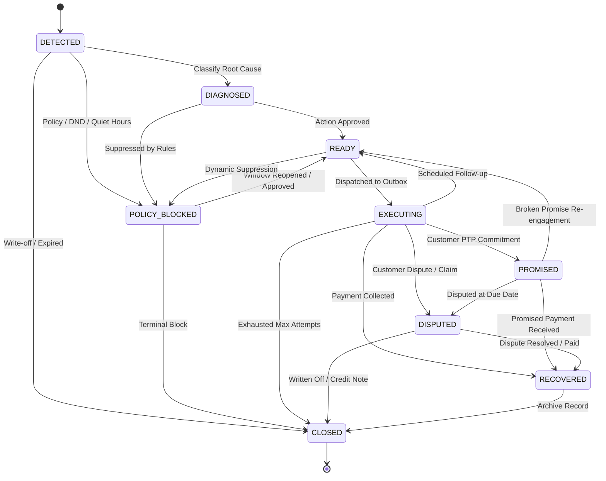

# Backstop — System Architecture, Contracts & Reliability Guarantees

## 1. Executive Summary & Architectural Mission

**Backstop** is an autonomous, economic revenue recovery agent designed to identify, diagnose, and recover at-risk revenue across 4 enterprise leakage vectors:
1. **Failed One-Off Payments** (Card declines, UPI intent drops, Netbanking timeouts)
2. **Abandoned Checkouts** (Cart drops at payment/shipping/OTP stages)
3. **Subscription Mandate Failures** (UPI Autopay & recurring e-Mandate execution drops)
4. **Overdue B2B Receivables** (Unpaid Net-30/60 commercial invoices)

Unlike naive recovery scripts that blindly blast SMS retries or double-charge customers upon restart, Backstop is architected from the ground up around **atomic idempotency, strict run partition isolation, deterministic PII sanitization, and mathematical net-expected-value optimization**.

---

## 2. Core Problem Solved: Ledger Contamination & The −100% Lift Bug

### The Flaw in Legacy Systems
In previous architectures, all recovery actions were committed to a single, monolithic SQLite table without isolation between benchmark runs, live demos, and simulated crash tests.
- When an operator or automated test ran a crash scenario, transactions were marked as `EXECUTED`.
- When a subsequent benchmark or evaluation batch executed on the same database, the agent saw `EXECUTED` state and skipped every single case as an idempotent no-op.
- Evaluators reported **−100% recovery lift** or wildly distorted recovery metrics.

### Backstop's Run-Isolated Architecture
Backstop solves this through **Run Partition Isolation**:
- Every operational execution, benchmark, simulation, or live batch is assigned an explicit or default `run_id` (e.g. `run_batch_20261102_001`, `demo_run`, `bench_eval_42`).
- The primary key of every action in the ledger is compound: `PRIMARY KEY (run_id, idempotency_key)`.
- Benchmark runs and demo executions never contaminate each other, even when processing identical customer cases.
- Dedicated `purge_run(run_id)` APIs allow zero-side-effect test cleanups.
- Zero-overhead in-memory mode (`db_path=":memory:"`) enables blazing fast test suites without creating disk artifacts.

```
                      ┌───────────────────────────────────────┐
                      │             Backstop Agent            │
                      └──────────────────┬────────────────────┘
                                         │
                         Assigns RunID: "run_A" / "run_B"
                                         │
                                         ▼
            ┌─────────────────────────────────────────────────────────┐
            │               Partitioned Recovery Ledger               │
            │                  (SQLite WAL Mode)                      │
            ├────────────────────────────┬────────────────────────────┤
            │       Run Partition:       │       Run Partition:       │
            │          "run_A"           │          "run_B"           │
            ├────────────────────────────┼────────────────────────────┤
            │ • Actions: key1 (EXECUTED) │ • Actions: key1 (PENDING)  │
            │ • Audit Trail (Run A)      │ • Audit Trail (Run B)      │
            └────────────────────────────┴────────────────────────────┘
```

---

## 3. Canonical Domain Contracts & Lifecycle State Machine

All agent modules communicate via typed, immutable dataclasses defined in `engine/models.py`.

### A. Supported Leak Types (`LeakType`)
- `failed_payment`: One-off card/UPI/netbanking transaction failure
- `abandoned_checkout`: Customer abandoned cart at payment, OTP, or address entry
- `subscription_mandate`: Recurring subscription auto-debit renewal failure
- `b2b_invoice`: Overdue invoice receivables past Net-30/60 terms

### B. Lifecycle State Machine (`CaseState`)


### C. State Machine Transition Rules
Transition validity is strictly enforced via `validate_transition(from_state, to_state)`. Illegal transitions (e.g. transitioning directly from `CLOSED` to `READY` or from `DETECTED` to `RECOVERED` without diagnosis and dispatch) raise a `ValueError`.

### D. Interventions (`ActionType`)
1. `retry_immediate` — Sub-second network retry for transient transport errors
2. `retry_delayed` — Exponential backoff retry timed to bank batch clearing
3. `reroute_gateway` — Switch acquirer route during bank/gateway degradation
4. `card_update_link` — Secure Razorpay checkout link for expired/blocked cards
5. `mandate_retry_sequence` — Compliant pre-debit notice and presentation retry
6. `reminder_sms` — Contextual SMS with 1-click payment link
7. `whatsapp_nudge` — Rich interactive WhatsApp template with quick-reply buttons
8. `voice_call_hinglish` — Natural conversational voice bot with mid-call payment link
9. `discount_incentive` — Margin-capped dynamic concession for high-intent abandoned carts
10. `human_escalation` — Escalation to senior account manager for high-value / low-confidence cases
11. `do_nothing` — Strategic no-op when recovery probability or expected value does not justify outreach cost

---

## 4. Idempotency & Crash-Resilient State Machine

### Deterministic Key Generation
Every action produces a deterministic 24-character SHA-256 idempotency key:
$$\text{key} = \text{SHA256}(\text{customer\_id} : \text{case\_id} : \text{attempt\_number} : \text{action})[:24]$$

### The Atomic Two-Phase Execution Contract
1. **Phase 1: `begin_action(run_id, customer_id, case_id, attempt_number, action, ...)`**
   - Atomically checks `actions` table within `run_id`.
   - If already recorded as `EXECUTED`, `SKIPPED`, or `FAILED`:
     - Returns `(key, should_execute=False, existing_state)`.
     - Logs an immutable `SKIPPED` audit record.
   - If not found:
     - Atomically writes record with `state="PENDING"`.
     - Returns `(key, should_execute=True, "PENDING")`.
2. **Phase 2: `complete_action(run_id, key, success, result_detail)`**
   - Transitions state from `PENDING` to `EXECUTED` (or `FAILED`).
   - Appends outcome metadata to `detail_json`.
   - Records an immutable state transition event in `audit_events`.

### In-Flight Crash Recovery
If a process is killed abruptly mid-batch:
- `recover_inflight_actions(run_id)` scans for actions trapped in `PENDING` state.
- Resumed runs identify previously completed actions and mark them `SKIPPED` without double-dispatching messages or double-charging cards.

---

## 5. High-Speed Deterministic PII Sanitization

To ensure zero customer data leaks in logs, telemetry, dashboards, and evaluation reports, `engine/pii.py` provides microsecond deterministic masking:

| Data Type | Raw Input Example | Sanitized Output | Privacy Guarantee |
| :--- | :--- | :--- | :--- |
| **Phone Number (with Country Code)** | `+91 98765 43210` | `+91 98••• ••210` | Country code & first 2 / last 3 digits clear; middle 5 digits obliterated. |
| **10-Digit Mobile** | `9876543210` | `98•••••210` | First 2 & last 3 digits clear; middle 5 digits masked. |
| **Email Address** | `ananya.sharma@example.com` | `a•••••a@example.com` | First/last characters of user local-part visible; domain preserved. |
| **Customer Name** | `Rohan Gupta` | `R•••• G••••` | Initials preserved; tokens deterministic masked. |
| **Card Number (PAN)** | `4111 2222 3333 4242` | `•••• •••• •••• 4242` | PCI-DSS compliant; only last 4 digits visible. |
| **GSTIN (Indian Tax ID)** | `27AAPFU0939F1ZV` | `27••••••••••1ZV` | 2-digit State code and 3-digit entity checksum clear; 10-digit PAN masked. |
| **Nested Dictionaries** | `{"contacts": [{"phone": ...}]}` | Deep recursive copy | Original payload unaltered; all nested PII masked. |
| **Free-Form Text & Logs** | `"Contact 9876543210 on..."` | Regex substituted | Zero regex matches for 10-digit mobile or card PANs survive. |

---

## 6. Central Configuration & Policy Levers

All environment variables, operational thresholds, and compliance stopping rules are unified in `engine/config.py`:

```python
from engine.config import config, load_config

# Config parameters:
config.SQLITE_DB_PATH          # default "models/recovery_ledger.db"
config.DEFAULT_RUN_ID          # default "default_run"
config.MAX_ATTEMPTS            # default 3 touches maximum
config.CONFIDENCE_HUMAN_FLOOR  # default 0.35 (below this routes to human review)
config.MARGIN_DISCOUNT_CAP_PCT # default 0.10 (max 10% incentive concession)
config.QUIET_HOURS_START       # default 19 (7:00 PM)
config.QUIET_HOURS_END         # default 8  (8:00 AM)
config.HOLDOUT_RATIO           # default 0.15 (15% true untreated control group)
```

### Compliant Contact Windows (RBI / TRAI)
Outbound contacts outside permissible business hours are automatically blocked:
```python
is_blocked = config.is_quiet_hours(hour=21)  # Returns True (9 PM is quiet hours)
is_allowed = config.is_quiet_hours(hour=14)  # Returns False (2 PM is active hours)
```

---

## 7. Multi-Agent Concurrency & Ownership Rules

To allow 7 autonomous engineering agents to work in parallel on the codebase without collisions:

1. **Agent 0 (You):** Exclusively owns `engine/models.py`, `engine/config.py`, `engine/ledger.py`, `engine/pii.py`, `engine/__init__.py`, `tests/test_foundation.py`, and `docs/ARCHITECTURE.md`.
2. **Backwards Compatibility:** All legacy APIs (7-parameter `begin_action`, 3-parameter `complete_action`, `txn_id` aliases) remain supported so existing modules operate seamlessly while migrating to the canonical architecture.
3. **Run ID Purity:** Every agent that runs batch operations, simulations, or unit tests uses isolated `run_id` namespaces.
4. **Database Thread Safety:** SQLite WAL mode with `PRAGMA synchronous=NORMAL` and thread-safe re-entrant locking (`threading.RLock`) guarantees zero database locking contention under concurrent execution.
